<h1 align="center">
  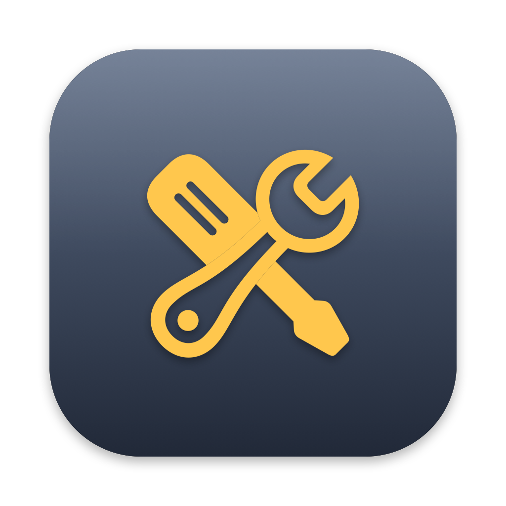<br>
  MacOS Toolkit
</h1>

<p align="center">
  <b>The little things macOS never shipped, in one menu bar app.</b><br>
  A volume slider for every app. A ⌘Tab that lists windows. Windows snapped to halves or a grid,
  from the keyboard or by dragging. Mouse settings that stick, per mouse.
  ⌘X, swipe back and forward, and a better right-click menu in Finder. Screenshots and small screen recordings on ⇧⌘3/4/5.
  A Mac that stays awake for as long as you need. CPU, memory and more in the menu bar, with memory that
  means something.
</p>

<p align="center">
  <a href="https://github.com/joafalves/macos-toolkit/releases/latest"></a>
  
  
</p>

<p align="center">
  <a href="#the-menu-bar">
    <picture>
      <source media="(prefers-color-scheme: dark)" srcset="docs/images/menu-bar-strip-dark.png">
      
    </picture>
  </a>
</p>

<table>
  <tr>
    <td align="center" width="50%">
      <a href="#audio-mixer">
        <picture>
          <source media="(prefers-color-scheme: dark)" srcset="docs/images/mixer-dark.png">
          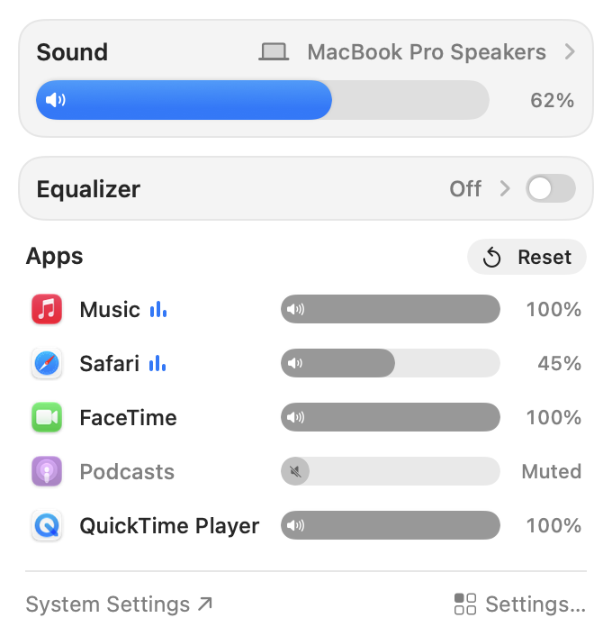
        </picture><br>
        <b>Audio Mixer</b>
      </a>
    </td>
    <td align="center" width="50%">
      <a href="#window-switcher">
        <picture>
          <source media="(prefers-color-scheme: dark)" srcset="docs/images/switcher-dark.png">
          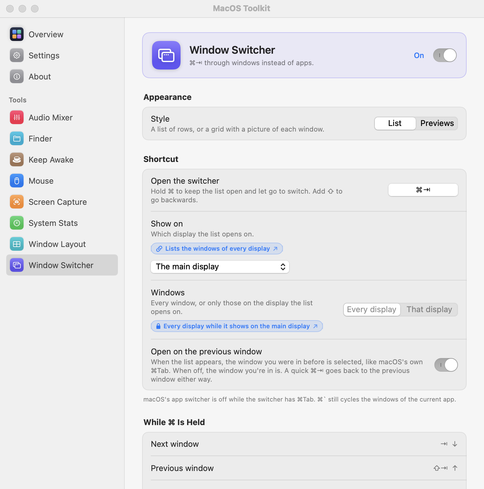
        </picture><br>
        <b>Window Switcher</b>
      </a>
    </td>
  </tr>
  <tr>
    <td align="center" colspan="2">
      <a href="#window-layout">
        <picture>
          <source media="(prefers-color-scheme: dark)" srcset="docs/images/layout-grid-dark.png">
          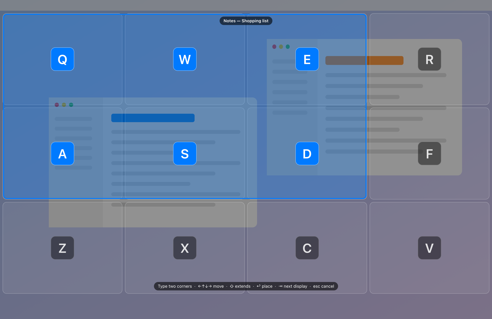
        </picture><br>
        <b>Window Layout</b>
      </a>
    </td>
  </tr>
  <tr>
    <td align="center" width="50%">
      <a href="#mouse">
        <picture>
          <source media="(prefers-color-scheme: dark)" srcset="docs/images/mouse-dark.png">
          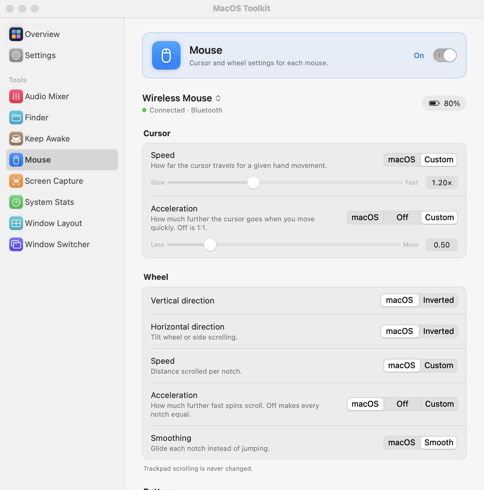
        </picture><br>
        <b>Mouse</b>
      </a>
    </td>
    <td align="center" width="50%">
      <a href="#finder">
        <picture>
          <source media="(prefers-color-scheme: dark)" srcset="docs/images/finder-dark.png">
          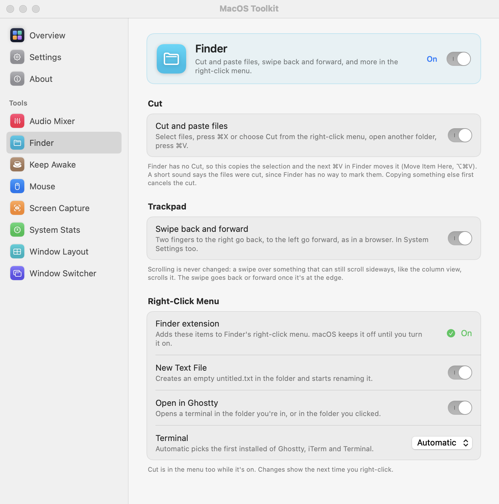
        </picture><br>
        <b>Finder</b>
      </a>
    </td>
  </tr>
  <tr>
    <td align="center" colspan="2">
      <a href="#screen-capture">
        <picture>
          <source media="(prefers-color-scheme: dark)" srcset="docs/images/capture-toolbar-dark.png">
          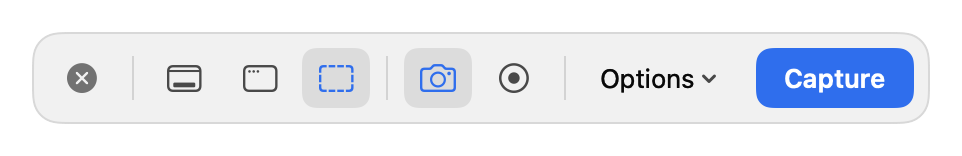
        </picture><br>
        <b>Screen Capture</b>
      </a>
    </td>
  </tr>
  <tr>
    <td align="center" colspan="2">
      <a href="#keep-awake">
        <picture>
          <source media="(prefers-color-scheme: dark)" srcset="docs/images/awake-dark.png">
          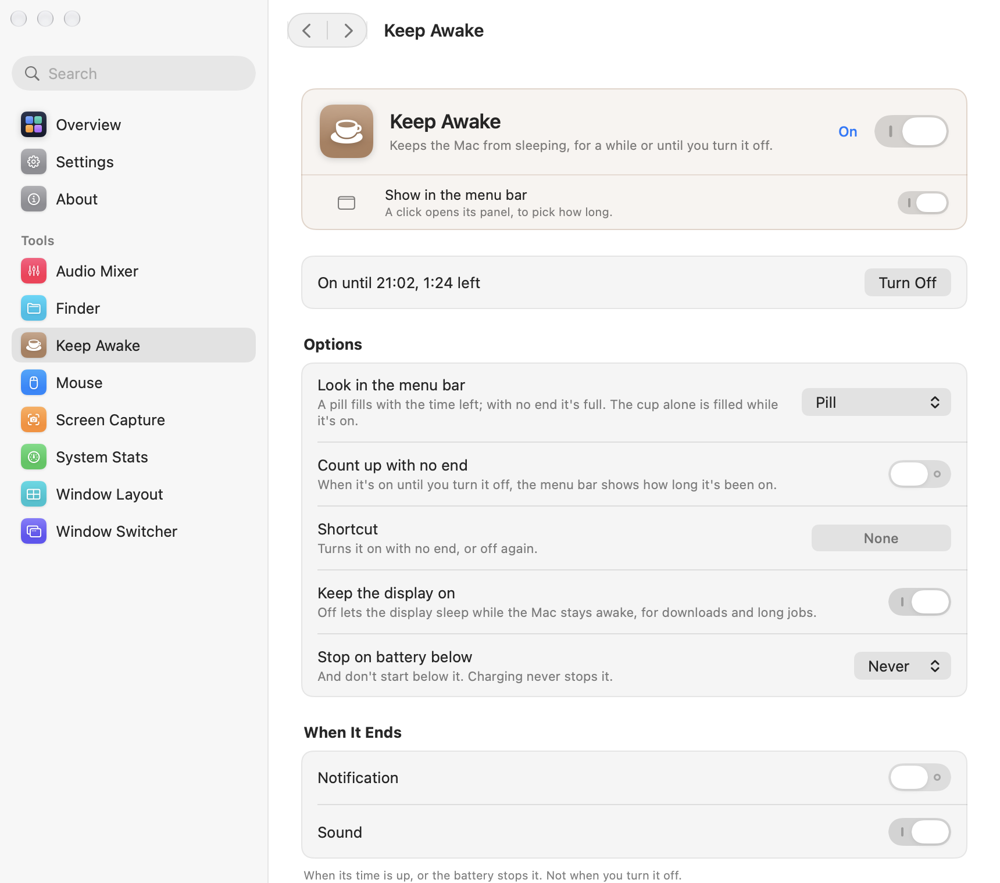
        </picture><br>
        <b>Keep Awake</b>
      </a>
    </td>
  </tr>
  <tr>
    <td align="center" colspan="2">
      <a href="#system-stats">
        <picture>
          <source media="(prefers-color-scheme: dark)" srcset="docs/images/stats-memory-dark.png">
          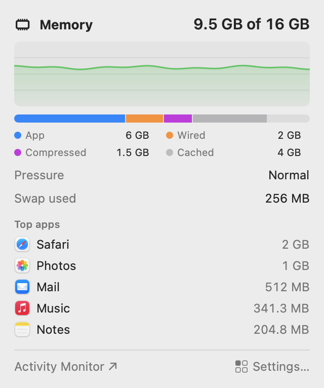
        </picture><br>
        <b>System Stats</b>
      </a>
    </td>
  </tr>
</table>

I missed a few things from Windows and from third-party apps, and I didn't want three more apps
running to get them. So this is one small app, written in Swift with no dependencies, where each
tool is a section in the sidebar and (where it makes sense) an entry in the menu bar.

| Tool | What it does |
| --- | --- |
| 🎚️ **[Audio Mixer](#audio-mixer)** | A volume for each app, like the Windows volume mixer, plus an equalizer and volume control for outputs that have none. |
| 🪟 **[Window Switcher](#window-switcher)** | ⌘Tab lists *windows*, not apps (AltTab-style), across all Spaces. |
| 🔲 **[Window Layout](#window-layout)** | Rectangle's shortcuts for halves, quarters and thirds, a grid you place windows on with two keys, snapping by dragging, and stacks of windows sharing a slot (a preview). |
| 🖱️ **[Mouse](#mouse)** | Cursor and wheel settings per mouse (SteerMouse-style), autoscroll on the wheel button, plus battery level. |
| 📁 **[Finder](#finder)** | ⌘X to cut files, two-finger swipes back and forward, and New Text File and Open in Terminal in the right-click menu. |
| 📸 **[Screen Capture](#screen-capture)** | ⇧⌘3/4/5 screenshots and screen recordings (CleanShot-style), with window backdrops and small H.264 files. |
| 📊 **[System Stats](#system-stats)** | CPU, memory, network, disk, GPU and power in the menu bar (Stats-style), with a memory figure that leaves out what macOS only caches. |
| ☕ **[Keep Awake](#keep-awake)** | Keeps the Mac awake for a while or until you turn it off (Amphetamine-style), with the lid closed if you like. |

Each tool can be turned off or left on its macOS defaults, and anything the app changes outside
itself is put back when it quits. No accounts, no telemetry, no network code. Settings are plain JSON in
`~/Library/Application Support/MacOS Toolkit`, and **Settings → Export…** saves them all to one file.
**Import…** takes the file's settings and leaves the rest as they are.

## Audio Mixer

<p align="center">
  <picture>
    <source media="(prefers-color-scheme: dark)" srcset="docs/images/mixer-dark.png">
    
  </picture>
  &nbsp;&nbsp;
  <picture>
    <source media="(prefers-color-scheme: dark)" srcset="docs/images/mixer-equalizer-dark.png">
    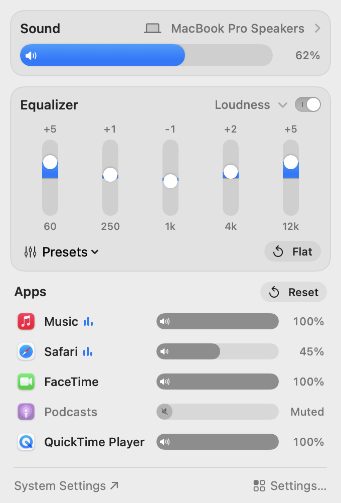
  </picture>
</p>

macOS has one volume for everything. The mixer adds the missing part: open it from the menu bar and
every app that has sound gets its own slider.

- **Main volume and output device** at the top, so it replaces a trip to Control Center.
- **A row per app**: every Dock app that has sound open (so Spotify is there before you press play),
  and menu bar apps once they've actually played. Apps making sound right now come first, with
  moving bars. Browser and Electron helpers are folded into their app.
- **Relative to the main volume**: an app at 50% plays at half of whatever the main volume is, and
  the volume keys still move everything.
- **Click an app's icon or row to mute** (0% counts as muted, and unmuting restores where it was).
- **Reset** puts every app back to 100%, so they all follow the main volume again.
- Volumes are remembered per app. Right-click an app to hide it until it plays again, or to
  **Exclude** it: excluded apps are left out of the mixer and always play at the main volume.
- A place in the **menu bar**, one click away, set in the mixer's settings: none, the mixer glyph,
  **Volume**, a speaker that follows the volume and shows when it's muted, **Volume and
  percentage**, or **Volume pill**, a pill that fills with the volume like the battery, with the
  speaker and the number cut out of it.
- **The volume keys** go through the mixer on every output while it's on, so they always behave the
  same: 5% a press (1% with ⇧⌥), mute toggles, and the toolkit's own on-screen bar in place of
  macOS's. On outputs with a volume of their own that volume is set directly; on the rest it's the
  software volume. ⌥ with a volume key still opens Sound settings. Needs **Accessibility**.
- **Software volume** for outputs that have no volume control of their own (see below).
- An **equalizer** under the main volume: five bands (60 Hz to 12 kHz, ±12 dB) with presets such as
  Bass Boost, Vocal, Loudness and Late Night. Drag a band, or double-click it for 0 dB. While it's on
  and not flat, all sound goes through the toolkit, the same way as the software volume, so macOS
  shows its recording indicator. Strong boosts are kept from clipping with a little headroom and a
  soft limiter.

### Outputs with no volume control

<p align="center">
  <picture>
    <source media="(prefers-color-scheme: dark)" srcset="docs/images/mixer-outputs-dark.png">
    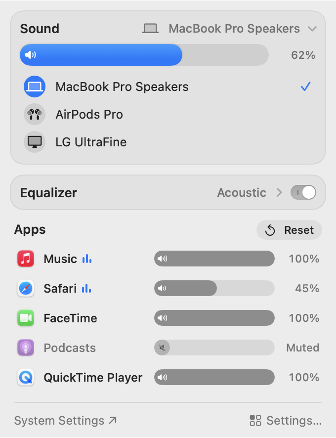
  </picture>
</p>

Many monitors over HDMI or DisplayPort show up in macOS with no volume at all: the slider is greyed
out and the volume keys show a "not allowed" icon. For those outputs the mixer takes over:

- The **main slider** works there too, marked with a small chip icon.
- It lowers the sound in software: one tap on everything that plays to that output, scaled down and
  played again. Per-app volumes keep working on top. Each output remembers its own volume.
- The tap stays up at 100%, passing the sound through untouched, because taking it down there would
  reroute the audio mid-playback and click. So for as long as it is on, macOS shows its purple
  recording indicator and the sound is delayed by about one audio buffer.
- It needs the **System Audio Recording** permission and, for the keys, **Accessibility**. It is
  built for macOS 26 and later; on macOS 15 it may not start.
- Turn it off in the mixer's settings under **Software volume**.

<details>
<summary><b>How it works, and what it costs</b></summary>

<br>

macOS has no setting for one app's volume, so the mixer uses Core Audio *process taps*: it captures
an app's sound (which silences the original) and plays it again at the volume you chose. That needs
the **System Audio Recording** permission, which macOS asks for the first time you turn an app down.

- Apps at 100% and not muted are never rerouted. They play exactly as before. An app put back to
  100% keeps its tap until its sound stops, and so does the equalizer when it's turned off, because
  removing a tap mid-playback reroutes the audio and clicks.
- To tell real sound from an app that keeps its output open in silence (a paused Safari tab, Discord,
  games), the panel listens to each running app, but only while it is open.
- macOS shows its purple recording indicator whenever a tap runs. Outside the panel that means only
  while an app you turned down or muted is making sound.
- A tapped app's sound is delayed by about one audio buffer, a few milliseconds on built-in and wired
  outputs. The real figure is logged when a tap starts
  (`log stream --predicate 'process == "Toolkit"'`). Bluetooth outputs may add more; I haven't
  measured that.
- Taps are removed when the toolkit quits, and any a crash left behind are removed at the next launch.
  Volumes are stored in `mixer.json`.

</details>

## Window Switcher

<p align="center">
  <picture>
    <source media="(prefers-color-scheme: dark)" srcset="docs/images/switcher-dark.png">
    
  </picture>
</p>

⌘Tab opens a list with **one row per window**, never grouped by app, across all Spaces and displays.
Rows are in most recently used order, so row 1 is the window you are in, and a quick ⌘Tab goes back
to the previous one without showing the list at all. When the list does appear, the previous window
is selected, or the one you're in with **Open on the previous window** off. Minimized windows, hidden apps and apps without
a window come last, dimmed.

| Key (while ⌘ is held) | Action |
| --- | --- |
| ⇥ / ⇧⇥, ↓ / ↑ | Next / previous row |
| 1 – 9 | Go straight to that row |
| release ⌘, or click | Go to the selected row |
| esc | Cancel |
| W, M | Close / minimize the window |
| H, Q | Hide / quit the app |
| X | Quit every app that only has dimmed rows (hidden, no windows, or all minimized), except Finder |

The list opens on the main display, the display with the pointer, or the one with the active window,
as you choose in the settings. **Windows** lists every window, or only those on the display the list
opens on, each counted on the display with most of it; hidden apps and apps with no window are on no
display, so they're left out then. On the main display it always lists every window: it's the same
display wherever you work, so only its own would hide the rest. ⌘\` is left alone.

### Previews

<p align="center">
  <picture>
    <source media="(prefers-color-scheme: dark)" srcset="docs/images/switcher-grid-dark.png">
    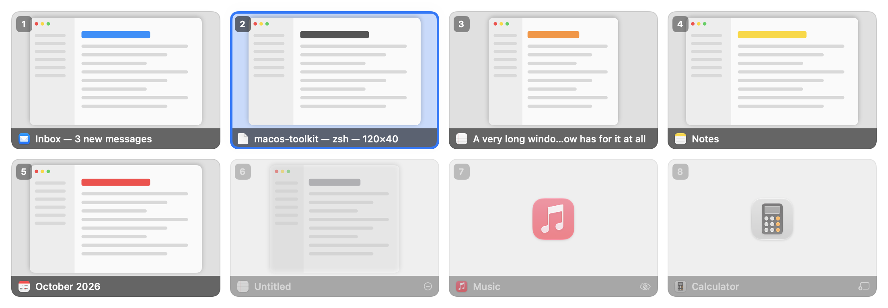
  </picture>
</p>

With **Style: Previews** in the settings, the list becomes a grid with a picture of each window, its
app and title along the bottom. ← → step through the tiles, ↑ ↓ go to the row above and below, and
the other keys work as in the list. Minimized windows keep their last picture, dimmed; hidden apps
and apps without a window show their icon.

- **Size**: Small, Medium or Large is the largest a tile gets, and tiles shrink when there are more
  windows than fit, so there's never any scrolling. **Fit** makes them as large as the display allows.
- **Pictures**: **Cached** shows the last picture of each window at once and a new one a moment later,
  **Fresh** shows the app's icon until the new picture arrives, and **Live** keeps them updating
  while the switcher is open (more power).
- Pictures are only taken while the switcher is on screen, so a quick ⌘Tab takes none, and they're
  kept in memory only. They need the **Screen Recording** permission; without it the switcher shows
  the list.

⌘Tab is the default; the shortcut can be changed in the settings to any key with ⌘, ⌥ or ⌃. Its
modifiers are what you hold to keep the list open, and ⇧ goes backwards. With a shortcut other than
⌘Tab, macOS's own app switcher keeps working alongside.

It needs **Accessibility**, and relies on private macOS APIs to find windows on other Spaces, to
focus a single window, and to switch the system's own ⌘Tab off while the switcher has it. That is
switched back on when the toolkit quits or the tool is turned off.

## Window Layout

<p align="center">
  <picture>
    <source media="(prefers-color-scheme: dark)" srcset="docs/images/layout-grid-dark.png">
    
  </picture>
  <br><br>
  <picture>
    <source media="(prefers-color-scheme: dark)" srcset="docs/images/layout-dark.png">
    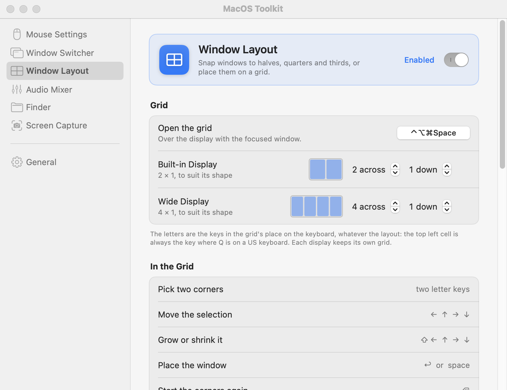
  </picture>
</p>

Snaps the focused window to part of its display. The keys are Rectangle's, so coming from it nothing
changes; each one can be changed or cleared in the settings.

| Key | Action |
| --- | --- |
| ⌃⌥ ← → | Left or right half. Again to move it on to the next display that way, as its near half. At the outer edge it stops, or goes through ⅔ and ⅓ with **Sizes at the outer edge** on |
| ⌃⌥↑ | Top half. Again to maximize, and again to move it, maximized, to the display above |
| ⌃⌥↓ | Bottom half, maximized windows too. Again to move it to the top half of the display below |
| ⌃⌥ U I J K | Top left, top right, bottom left, bottom right quarter |
| ⌃⌥ D F G | First, center, last third (down the display on one that stands upright) |
| ⌃⌥ E T | First, last two thirds |
| ⌃⌥↩ | Maximize, with the gap around it like the halves beside it. The toolkit places it itself rather than asking for macOS's Fill, so the menu bar above stays as it is (macOS darkens it only over a window it filled, as after a double-click on a title bar). Almost maximize (nine tenths, centered) is there too, without a key |
| ⌃⌥⇧↑ | Maximize the height, keeping the width |
| ⌃⌥C | Center |
| ⌃⌥= ⌃⌥- | Larger, smaller: 30 points on every side |
| ⌃⌥⌫ | Restore the size and place it had before it was snapped |
| ⌃⌥⌘ ← → | Previous, next display. A snapped window stays snapped the same way |
| ⌃⌥⌘D | Show the desktop, as with macOS's own gesture: every window slides aside, and the same keys (or a click on one) bring them back where they were, snapped ones still snapped |

The arrows go by where the window is, however it got there: a window you maximized yourself goes
straight to the display above with ⌃⌥↑, and one already at the left half moves on to the display on
the left with ⌃⌥←.

### The grid

**⌃⌥⌘Space** lays a grid over the display with the focused window, a key on each cell. Type the key
of one corner, then the key of the opposite corner, and the window fills that block: on the 4 × 3
grid like the one above, Q then D is three quarters wide and two thirds high.

| Key (in the grid) | Action |
| --- | --- |
| two letter keys | One corner, then the other. The same key twice is one cell |
| ← → ↑ ↓ | Move the selection |
| ⇧ ← → ↑ ↓ | Grow or shrink it |
| ↩ or space | Place the window |
| ⌫ | Start the corners again |
| ⇥ | Move the grid to the next display, to send the window there |
| esc | Cancel |

Dragging across the cells with the mouse works too.

- The keys go by **where they sit on the keyboard**, not by letter: the top left cell is always the
  key right of Tab, on any keyboard layout, and the cells show what your layout types there. Up to
  three rows use the letter rows; a fourth adds the number row.
- **Each display has its own grid**, up to 10 columns and 4 rows, set in the settings. Until it has
  one, a display gets halves (2 × 1), an ultrawide quarters (4 × 1), and one standing upright 1 × 2.
  Grids are kept per monitor, so two monitors that take turns on the same cable each keep theirs.

### Dragging

- **Snap at the edges**: drag a window to a side of the display or the bottom for half of it, to a
  corner for a quarter, or to the top to fill it. A preview shows where it will go. The menu bar and
  the Dock count as part of their edge, so the top snaps as soon as the pointer reaches the menu bar.
  Sides against another display snap too, in a strip 24 points wide (8 at the outer edges): stop
  short of the edge and let go. Keep going and the window crosses over as usual.
- **Layouts while dragging**: hold ⌥ while dragging and a bar of small layouts appears by the
  pointer: the whole display, halves both ways, thirds, ⅔ and ⅓, quarters, and on an ultrawide
  fourths and a wide middle. Move onto a part of one, and the screen shows where the window will go;
  let go to put it there.
- **Grid while dragging**: hold ⇧ while dragging and the grid appears. The cell under the pointer
  is one corner: move to the other and let go. Let go of ⇧ to start the corners again.
- **Esc** during the drag drops the window where it is, without snapping. Both keys can be changed
  or turned off in the settings.
- **Stop at the edge between displays** (off unless turned on): while a window is dragged, the
  pointer stops where one display meets another, so the snap on that edge is easy to hit. Moving
  away or along the edge lets go at once, and pushing on for a moment crosses over. Once through,
  the rest of that drag moves freely between the displays. A
  fast flick is held as long as a steady push. Only while dragging; the pointer moves between
  displays as usual otherwise.
- A snapped window you drag away gets back the size it had before, with the pointer at the same
  place on it. ⌃⌥⌫ puts a window snapped by a drag back where it was before you picked it up.
- What's snapped where is kept across a restart of the app, an update, or a crash: Restore, a drag
  out and a new gap go on working for those windows. A window you moved
  while the app wasn't running is left as it is; after the Mac restarts, it starts afresh.
- When a display goes (unplugged, or the lid closed), the windows snapped on it are snapped the same
  way on the display macOS moves them to, so a left and right pair stays a pair. When the display
  is back, they go back to it as they were, unless you've moved them since.
- **Suggest windows for the rest** (on, set to Previews): after a window is dropped on an edge or
  into a layout from the ⌥ bar, the part of the display that's left shows your other windows on
  the current Space, most recently used first, as Windows' Snap Assist does. **Windows from other
  displays** sets whether yours elsewhere are offered: **only this display's**, **others' if it has
  none** (the default), or **always, after its own**. Click one, or
  press its number (arrows and ↩ work too), and it goes there; in a layout of three, the part after
  that is offered next. Esc, a click elsewhere or typing makes it go away. Nothing is offered for a
  part that already has a window in it, or after keyboard moves. It uses the Window Switcher's list
  and grid; **Previews** needs Screen Recording and shows the **List** until then.

<p align="center">
  <picture>
    <source media="(prefers-color-scheme: dark)" srcset="docs/images/layout-suggest-dark.png">
    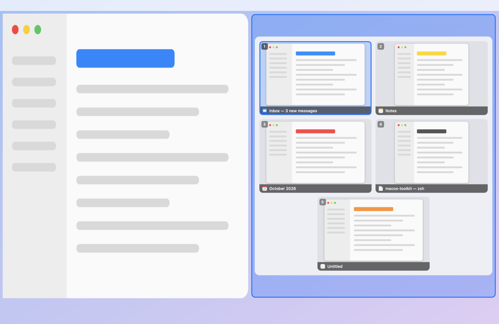
  </picture>
</p>

<p align="center">
  <picture>
    <source media="(prefers-color-scheme: dark)" srcset="docs/images/layout-slots-dark.png">
    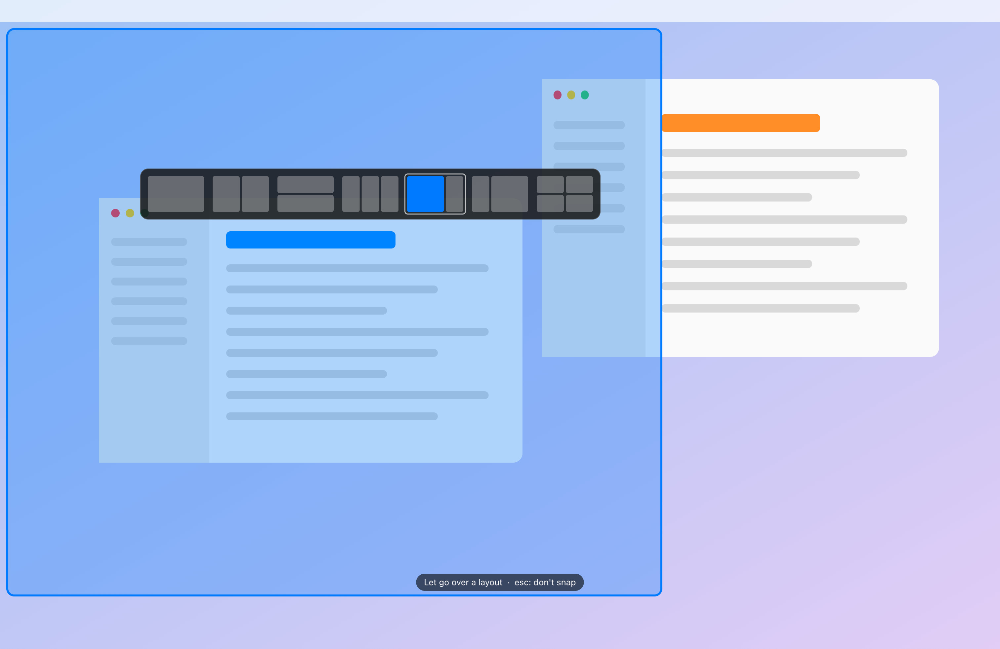
  </picture>
</p>

### Stacks (preview)

<p align="center">
  <picture>
    <source media="(prefers-color-scheme: dark)" srcset="docs/images/layout-tabs-dark.png">
    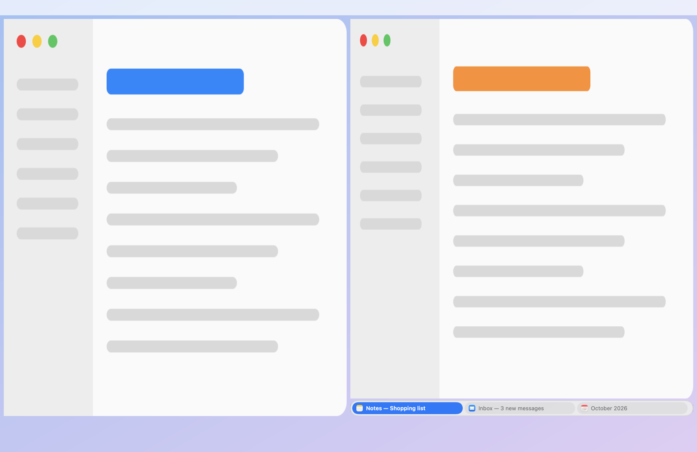
  </picture>
</p>

Several windows can be stacked in one slot, one shown at a time, with tabs to switch between them:
a browser and a terminal in the right half, say, whatever apps they're from. Stacks are a preview,
still rough in places, and off until turned on in the settings, under **Stacks**.

- **Stacking:** while dragging a window, hold **⌃**. Every window you can stack it with on that
  display is outlined: ones already in a stack, and ones in sight filling a half, third, quarter or
  grid block. Move over one (anywhere on it) and it says *Add as a tab*; let go and the two share
  its slot. Let go of ⌃ to snap as usual. **⌃⌥⇧↩** stacks the window you're in with the window
  under it.
- **Switching:** click a tab, or **⌃⌥⇥** / **⌃⌥⇧⇥** for the next and previous, **⌃⌥1–9** for one by
  number. A window brought forward any other way (⌘Tab, the Dock, a click) becomes the shown tab.
- **Leaving:** a window dragged out, resized so it no longer fits, closed or minimized leaves the
  stack, and so does one taken out with **⌃⌥⇧⌫** or by right-clicking its tab. With one left, it
  gets the whole slot back.
- The windows not shown wait behind the shown one at the same size, so switching is instant. The
  tabs sit just above the shown window, so a window of another app in front of the slot covers them
  too. They have titles, in a band of their own along the bottom of the slot by default, or the top.
- Stacks last as long as their windows; they don't come back after the toolkit or the Mac restarts.
  The key and the place of the tabs are in the settings under **Stacks**.

A **gap** of up to 40 points (8 to begin with, macOS's own margin) can go between windows and around the edges. macOS's own tiling
margins follow it while the tool is on: with no gap they're off, so double-clicking a title bar
(set to Fill in System Settings → Desktop & Dock) fills the whole display; with a gap they're on,
at macOS's fixed 8 points (there's no setting for their size).
macOS reads that setting only when its window manager starts, so the toolkit restarts it when the
setting changes (desktop widgets redraw for a moment). A window that can't take
the size (it has a minimum, or can't be resized) gets as close as it goes, centred on the spot.
Windows in full screen, panels, dialogs and sheets are left alone.

It needs **Accessibility**. While any kind of dragging is on, macOS's own tiling by dragging
(System Settings → Desktop & Dock → Windows) is switched off. Turning the tool or its dragging off
turns macOS's tiling on, so windows still snap; when the toolkit quits, it's put back as it was. If Rectangle is running, the settings offer to quit it, since the
two would fight over the same keys and drags.

## Mouse

<p align="center">
  <picture>
    <source media="(prefers-color-scheme: dark)" srcset="docs/images/mouse-dark.png">
    
  </picture>
</p>

Every setting has a **macOS** choice, meaning the toolkit leaves that behaviour to System Settings.
Profiles are per mouse, keyed by vendor ID, product ID and transport, so your settings come back as
soon as the same mouse is connected.

| Setting | Options | How |
| --- | --- | --- |
| Cursor speed | macOS / custom multiplier | `HIDPointerResolution` on the device's HID service |
| Cursor acceleration | macOS / off / custom (0–3) | `HIDMouseAcceleration` on the device's HID service |
| Wheel direction (vertical, horizontal) | macOS / inverted | scroll event tap |
| Wheel distance | macOS (its own, scaled) / fixed (lines a notch) / curve (a notch one distance, fast spins further, along a graph you drag) | scroll event tap; fixed and curve also switch `HIDMouseScrollAcceleration` off on the device, so a slow notch isn't shrunk to a point |
| Wheel smoothing | macOS / smooth | scroll event tap |
| Back and forward buttons | macOS / navigate | event tap; sends a navigation swipe to Apple apps |
| Wheel button | macOS / autoscroll, with a speed | event tap; posts scroll events while the button is held |

Cursor settings need no permission. The wheel and button settings that go through the event tap need
**Accessibility**. Trackpad scrolling is never modified. Fixed and curve set how far the wheel scrolls
up and down; sideways, a tilt scrolls a line at a time. They count each wheel event as a notch, as an
ordinary wheel sends them; a mouse whose own software (Logi Options+ and the like) makes its wheel
send fractions of a notch is left to that software.

**Autoscroll** is the Windows browser feature, in every app: hold the wheel button and move the mouse,
and the window scrolls that way, faster the farther you move from where you pressed. A marker shows
that spot, and letting go stops. A wheel click without moving is still a normal middle click, so
links still open in new tabs. Hold **⌥** (or the key picked in the settings) while pressing the wheel
to get the app's own behaviour for that press, such as its own autoscroll or panning, without giving
up autoscroll in that app. Apps that should always get the button (design apps that pan with it,
remote desktops, virtual machines) can be added to **Leave the wheel button to these apps**; the app
under the cursor when you press decides. Both count for every mouse.

## Finder

<p align="center">
  <picture>
    <source media="(prefers-color-scheme: dark)" srcset="docs/images/finder-dark.png">
    
  </picture>
</p>

Finder has no Cut. The usual way to move files with the keyboard is ⌘C, then ⌥⌘V ("Move Item Here")
in the destination. This does it with ⌘X and ⌘V:

1. Select files in Finder and press **⌘X** (or choose **Cut** from the right-click menu). They are
   copied, and marked as a cut.
2. Open the destination and press **⌘V**. Finder moves them there instead of copying.

Only keys pressed while Finder is in front are touched, and not while a name or the search field is
being edited, where ⌘X and ⌘V keep their text meaning. Copying anything else in between cancels the
cut, and a ⌘V somewhere other than Finder just pastes a copy. Finder can't dim the cut files the way
Windows does, so a short sound says the cut worked instead. Cut needs **Accessibility**.

Finder also doesn't go back and forward on a two-finger swipe, which browsers do. With **Swipe back
and forward** on, swiping two fingers to the right on the trackpad goes back and to the left goes
forward, in the Finder window under the cursor. System Settings gets the same swipe, since it has
Back and Forward but no swipe either. Finder is sent the navigation swipe a three-finger swipe
makes; System Settings ignores that, so its own Back or Forward menu item is pressed. Scrolling
is never changed: a swipe over something that can still scroll sideways (the column view, a wide
list) scrolls it, and only goes back or forward once it's at the edge. Other apps are left alone.
It needs **Accessibility** too.

The right-click menu gets these items, each of which can be turned off in the Finder settings:

| Item | What it does |
| --- | --- |
| Cut | The same as ⌘X, on the files you right-clicked. |
| New Text File | Makes an empty `untitled.txt` in the folder and starts renaming it (the rename needs **Accessibility**). |
| Open in Terminal | Opens a terminal in the folder you clicked, or the one you're in. The item is named after the terminal: Ghostty, iTerm or Terminal, the first one installed, or the one picked in the settings. |

The menu comes from a **Finder extension** inside the app. macOS keeps new Finder extensions off, so
turn it on once with **Turn On** in the Finder settings (or under System Settings → General → Login
Items & Extensions). The extension runs in its own sandboxed process and only builds the menu and
hands each choice to the app, which does the work. The app only takes those choices from its own
extension, which proves itself with a secret that changes at every launch, and only ever acts on
folders. Creating a file in a protected folder such as Documents may make macOS ask for access the
first time.

## Screen Capture

<p align="center">
  <picture>
    <source media="(prefers-color-scheme: dark)" srcset="docs/images/capture-toolbar-dark.png">
    
  </picture>
  <br><br>
  <picture>
    <source media="(prefers-color-scheme: dark)" srcset="docs/images/capture-dark.png">
    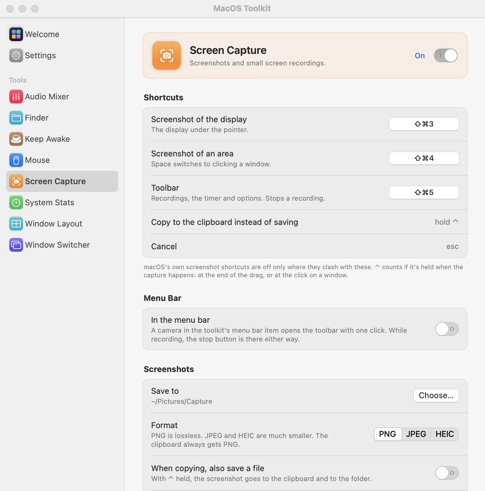
  </picture>
</p>

It takes over macOS's screenshot keys, with the same habits, and adds screen recordings small
enough to paste into a chat or a GitHub issue. The keys below are the defaults; each one can be
changed or cleared in the settings, and ⌃ added to the display or area shortcut always copies.

| Key | Action |
| --- | --- |
| ⇧⌘3 | Screenshot of the display under the pointer |
| ⇧⌘4 | Drag out an area. **Space** switches to clicking a window |
| ⇧⌘5 | The toolbar: display, window or area, screenshot or recording, timer and options. Stops a recording |
| hold ⌃ | Copy to the clipboard instead of saving a file. It counts if it's held when the capture happens, so it can be pressed mid-drag |
| esc | Cancel |

- **Screenshots** are saved to `~/Pictures/Capture` (or a folder you pick) as PNG, JPEG or HEIC.
  With ⌃ they go to the clipboard instead, and optionally to the folder as well. A thumbnail shows
  in the corner: drag it into an app, click it to open it, or let it go.
- **Windows** come out in one of three styles, picked in the toolbar's options: **Content Only**
  (without the title bar and toolbar, found through Accessibility; apps that draw their own title
  bar may keep part of it), **Plain** (no shadow), or **With Backdrop**: the window with a soft
  shadow on a blurred piece of your desktop picture or a solid color.
- **Recordings** are H.264 MP4, which plays inline almost everywhere, at 30 fps (15 and 60 in the
  settings). Three qualities: **Standard** records at point size (a quarter of the pixels on a
  Retina display) for small files, **High** keeps every pixel so small text stays sharp while it
  scrolls, and **Maximum** has detail to spare for code and tutorials. The settings show what a
  minute of constant motion costs on your display; frames are only written when something changes,
  so a mostly still screen costs far less. Optional system audio and microphone (mixed into one
  track), cursor and click rings. A window recording follows the window when it moves, and windows
  on top of it don't show.
- While recording, the menu bar shows a **stop button with the time and size** so far. Right-click
  it to pause, resume or discard. ⇧⌘5 stops too. When it stops, the file is saved to
  `~/Movies/Capture` (or a folder you pick) and put on the clipboard as a file, ready to paste.
- The toolbar remembers the last area. The toolkit's own toolbar, outline and thumbnails never show
  up in a capture.
- Optionally gets a **camera in the menu bar**, which opens the toolbar.

It needs the **Screen Recording** permission (and the microphone one, if you turn the mic on). macOS
asks again every so often to confirm it for apps that aren't Apple's. macOS's own screenshot
shortcuts are switched off only where they clash with the toolkit's, and back on when the toolkit
quits or the tool is turned off.

## Keep Awake

<p align="center">
  <picture>
    <source media="(prefers-color-scheme: dark)" srcset="docs/images/awake-dark.png">
    
  </picture>
</p>

A session keeps the Mac from sleeping until you turn it off, or for 5 minutes to 24 hours, or until a
time you pick. Start one from its panel in the menu bar, from its settings, or with a shortcut you
set. The panel shows the session, turned on or off with a click anywhere on it, and a bar of the time left;
the usual lengths are a click each, with the rest under More, and Until sets an end time a quarter
of an hour at a time. Keep the display on and Stay available are switches at the bottom. A session carries on if the app is restarted or the Mac reboots, until its time is up.

- **In the menu bar** it's a cup. While a session is on it becomes a **pill that empties as the time
  runs out**, with the time left in it (full, with no time, when it has no end), the cup with the
  time beside it, or only the cup, filled while it's on. With none, it sits in the toolkit panel: the cup turns it on or off, its name opens its panel. **Count up with no end**, off by
  default, shows how long a session with no end has been on instead.
- **Keep the display on** is the default. Turned off, only the Mac stays awake: the display sleeps,
  and downloads and long jobs go on.
- **Stay awake with the lid closed**, on battery too, is off by default. macOS only allows that to an
  admin, so turning it on asks for your password once and adds a rule to `/etc/sudoers.d` that lets
  the toolkit run `pmset -a disablesleep` and nothing else. Turning it off removes the rule. Sleep is
  put back when a session ends, when the app quits or is killed, and at the next launch after a
  crash. If the Mac gets too hot with the lid closed, the session ends. Being tied to this Mac, it's
  left out of exported settings.
- **On battery below a level you pick** (never, by default) a session ends, and none starts. Charging
  never ends one.
- **When it ends** on its own, a sound (the default), a notification, both or neither.

## System Stats

<p align="center">
  <picture>
    <source media="(prefers-color-scheme: dark)" srcset="docs/images/stats-bar-dark.png">
    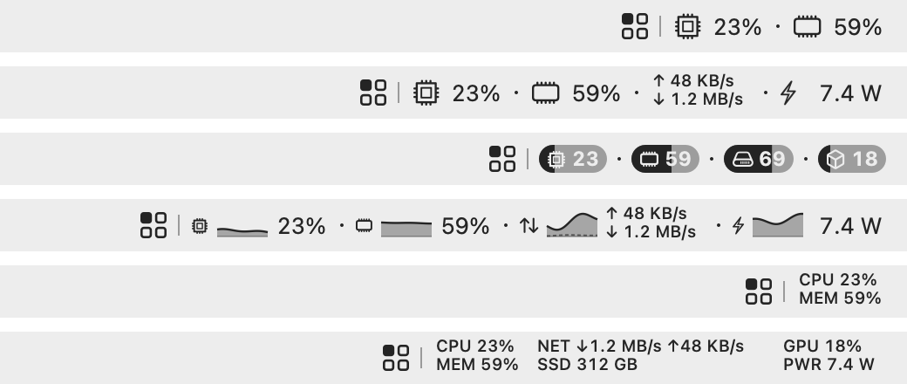
  </picture>
  <br><br>
  <picture>
    <source media="(prefers-color-scheme: dark)" srcset="docs/images/stats-cpu-dark.png">
    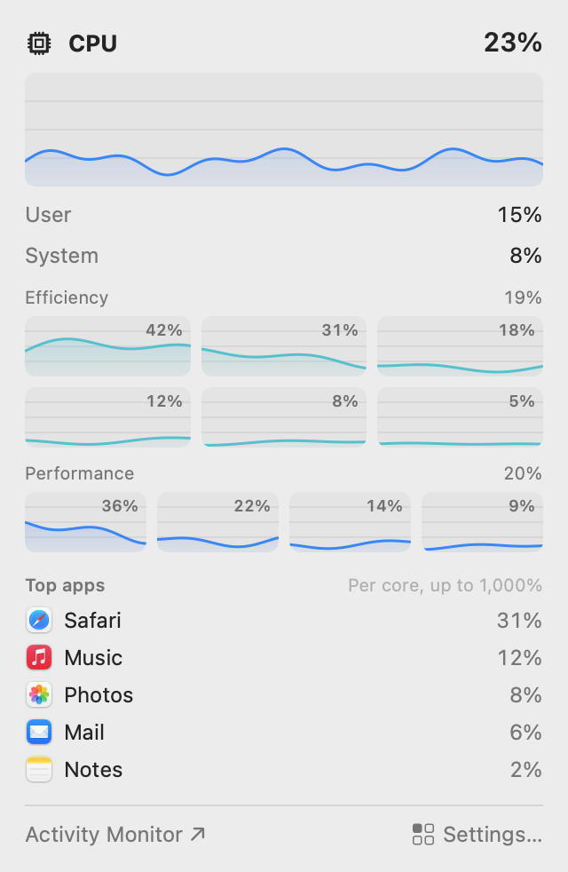
  </picture>
  &nbsp;&nbsp;
  <picture>
    <source media="(prefers-color-scheme: dark)" srcset="docs/images/stats-memory-dark.png">
    
  </picture>
</p>

What the Mac is doing, in the menu bar: **CPU**, **memory**, **network**, **disk**, **GPU** and
**power**. CPU and memory are on by default; turn on the others in the settings. Each stat is a
number with its icon, a pill that fills, or a chart of the last minute, or they all go in one
**compact** part as small labels. Click one for its last five minutes and the details.

- **Memory** shows what apps need: their memory, the kernel's, and what's compressed. Most monitors
  count everything that isn't free, but macOS fills spare memory with cached files it drops as soon
  as an app needs room, so that figure always looks nearly full and says little. With **Color memory
  when it runs short** on (off by default), it turns yellow, then red, when macOS itself reports
  memory running short. Its panel shows where memory goes, swap, and the apps using the most.
- **CPU** shows the share of all cores in use, and its panel each core's last minute as a small
  chart, grouped by kind, and the apps using the most, their helpers counted in, over the last five
  seconds: per core, as Activity Monitor counts them (100% is one core), or, with **Top apps' CPU of
  the whole CPU**, as a share of every core.
- **Network** shows upload and download speed on the connection in use, **disk** the free space
  and how fast it's read and written, and **GPU** how busy it is.
- **Power** shows what the Mac draws, from the battery's own readings, and in its panel the GPU's
  share, the charger, and the battery's charge, health and cycles. Some Macs only tell an admin
  what the CPU draws; there that line is left out. Desktops have no battery readings and show what
  the CPU and GPU draw.
- Figures stop at 99%, so each part keeps the same width and the menu bar doesn't shift.
- Every 2 seconds by default (1 or 5 in the settings). Only the stats in the menu bar are read, and
  nothing at all while none are, or the tool is off. A reading of all six costs under 2 ms.

## Install

Needs **macOS 15 or later**. The released app is built for Apple silicon.

### Download

1. Grab `MacOS-Toolkit-<version>.zip` from the [latest release](https://github.com/joafalves/macos-toolkit/releases/latest).
2. The app is signed with a self-signed certificate, not an Apple Developer ID, so remove the
   quarantine flag after unzipping:

   ```bash
   unzip ~/Downloads/MacOS-Toolkit-*.zip -d /Applications
   xattr -dr com.apple.quarantine "/Applications/MacOS Toolkit.app"
   open "/Applications/MacOS Toolkit.app"
   ```

### Updates

The app looks for a new release on GitHub when it starts and once a day (**About → Check
automatically**), and **Check Now** looks at once. A new version shows on About, with what's in it,
and at the top of the toolkit panel; nothing is installed until you press **Install and Relaunch**.
The download is only installed if it's signed with the same certificate as the app you have, which
is also what keeps the permissions you gave it; then the app restarts, and Finder too while the
Finder extension is on. No quarantine flag to remove. If you build the app yourself, it's signed with
your own certificate, so releases from GitHub won't install over it: update with `git pull` instead.

### Build it yourself

You only need the Xcode Command Line Tools (`xcode-select --install`, skip if `swift --version`
already works).

```bash
git clone https://github.com/joafalves/macos-toolkit.git && cd macos-toolkit
./scripts/make-cert.sh          # once per Mac: a local signing identity, so macOS keeps the permissions across rebuilds
./scripts/build.sh --install    # builds, copies to /Applications and launches
```

To update later: `git pull && ./scripts/build.sh --install`.

### First run

The window opens on **Overview**, with a tile for each tool and a warning while a permission one of
them needs is missing. It opens there again after an update; otherwise on the page you left.
**Settings**, under it, has the app's own settings, and **About** the version, updates, who made it,
and links to the project on GitHub.

- Every tool starts off. Click its tile, or its name in the sidebar, and turn it on with the switch
  at the top of its page.
- **Settings → Grant Access…** and enable *MacOS Toolkit* under System Settings → Privacy & Security →
  Accessibility. This is for the window switcher, Window Layout, the Finder cut and swipes, and the mouse wheel and button settings.
- System Audio Recording is asked for later, the first time you turn an app down in the mixer, and
  Screen Recording the first time you take a screenshot.
- For the Finder right-click menu, press **Turn On** in the Finder settings.
- Turn on **Launch at login** if you want it always there.
- To carry your settings to another Mac, use **Settings → Export…** and **Import…**.

To remove it, quit the app, delete it from `/Applications`, and delete
`~/Library/Application Support/MacOS Toolkit`.

## The menu bar

<p align="center">
  <picture>
    <source media="(prefers-color-scheme: dark)" srcset="docs/images/menu-bar-dark.png">
    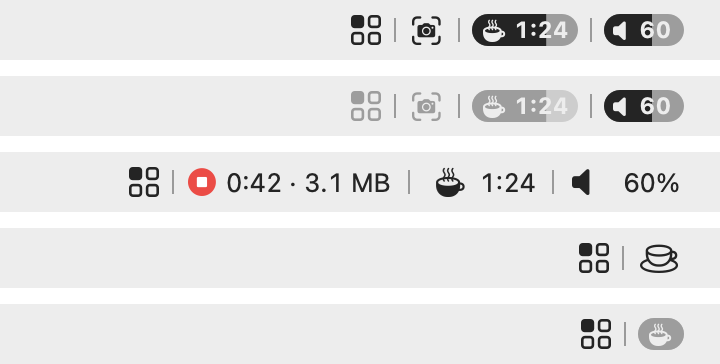
  </picture>
</p>

The toolkit has one item in the menu bar. The toolkit's mark is always there, and Screen Capture, Keep
Awake and the Audio Mixer join it when their settings put them in the menu bar, side by side with the same
size and spacing and a hairline between them. While recording, Screen Capture's place shows a red
stop button with the time and size. Each part opens its own menu or panel, and while one is open
the others dim. Being one item, they move together when you ⌘-drag it, share macOS's highlight,
and other apps' icons can't end up between them. **Settings → Space between items** sets how far apart the parts sit, and **Order** which comes
first: drag the tools, the toolkit's mark too, into the order you want, left to right. A switch on
each puts it in the menu bar or takes it out; a tool that's off opens its page instead.

<p align="center">
  <picture>
    <source media="(prefers-color-scheme: dark)" srcset="docs/images/toolkit-panel-dark.png">
    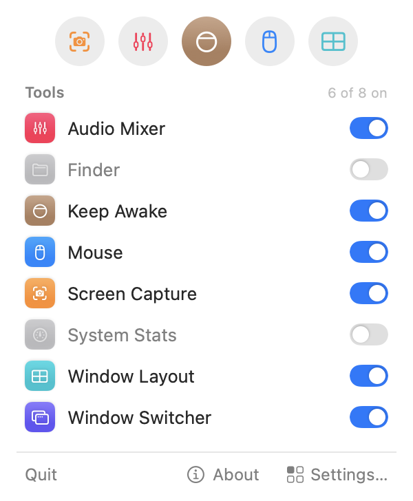
  </picture>
</p>

The toolkit's mark opens its panel. At the top are the tools that have no part of their own in the
menu bar: Screen Capture opens its toolbar (or stops a recording), the Audio Mixer opens the mixer,
and Keep Awake's cup turns it on with no end, or off, while its name opens its panel for a set time.
Then every tool, with a switch that turns it on or off and leaves the panel open, so you can set
several at once; a tool's name opens its settings. Quit and Settings are at the bottom.

## Languages

The app is in English and Portuguese (Portugal). It follows the order of your languages in macOS;
**Settings → Language** picks one for the app alone, from the next launch. The Finder menu follows
it too.

## Good to know

- It uses **private macOS APIs** (window discovery for the switcher, the permission check for the
  mixer, grouping helper processes under their app, switching off the system's ⌘Tab and screenshot
  keys). They can change in any macOS update, and this
  is a personal tool, so expect to rebuild when they do.
- It is **not notarized**, which is why the install steps above remove the quarantine flag.
- Anything the toolkit changes outside itself (⌘Tab, the screenshot keys, macOS's window tiling and its margins,
  device properties, audio taps, sleep with the lid closed) is put back when it quits, when it is killed, and at the next launch if it crashed.

## Project layout

```
Sources/Toolkit
├── App        menu bar items, main window, general settings, settings export, updates
├── Mouse      the Mouse tool
├── Switcher   the Window Switcher tool
├── Layout     the Window Layout tool
├── Mixer      the Audio Mixer tool
├── Finder     the Finder tool
├── Capture    the Screen Capture tool
├── Awake      the Keep Awake tool
├── Stats      the System Stats tool
└── UI         shared settings-page components
Sources/FinderExtension   the Finder extension behind the right-click menu
Resources      Info.plist, the icon, and the translations (pt-PT.lproj)
scripts        build.sh, make-cert.sh, make-icon.swift, strings.py, test-update.sh, test-persist.sh
docs/images    the screenshots above
```

What each version added and fixed is in [`CHANGELOG.md`](CHANGELOG.md). A tool is a controller plus a config, stored as JSON. [`AGENTS.md`](AGENTS.md) has the conventions,
the dev flags (`--snapshot` renders any page to an image, `--list-windows` and `--list-audio` print
what the tools see, `--test-capture` runs the screenshot and recording code without the UI, `--test-layout` places a helper's windows), and how versions and releases are made.

## License

Copyright 2026 João Alves. Licensed under the [Apache License, Version 2.0](LICENSE).
